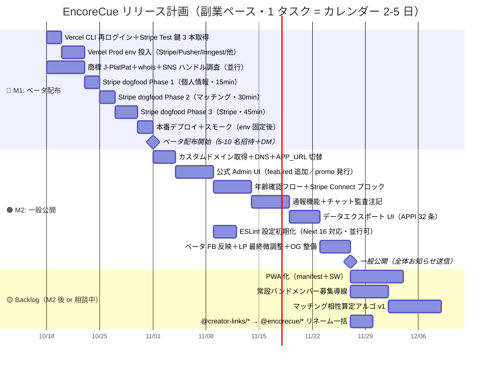

# EncoreCue リリース計画（Living Doc）

**作成日：** 2026-10-17
**最終更新：** 2026-10-17
**担当：** 沖山（TobojoLabs）
**前提ペース：** 副業週 10-15h（平均 1.8h/日）／開始日 2026-10-18（Sat）

> このファイルは「計画 × 進捗」を 1 枚で持つための Living Doc。タスク完了ごとに「状態」欄と Mermaid gantt の `:done` / `:active` を更新する。

---

## 0. マイルストーン定義

| # | ゴール | 条件 | 目標日 |
|---|---|---|---|
| **M1** | **ベータ配布（5-10 名）** | Stripe dogfood 完走 + Prod env 充足 + 商標一次確認 OK | **2026-11-10 前後** |
| **M2** | **一般公開（正式ローンチ）** | カスタムドメイン + 年齢確認 + 通報 + データエクスポート UI + ベータ FB 反映 | **2027-01-中** |

ベータ配布中は `creator-links-web.vercel.app` を継続利用。M2 でカスタムドメイン切替。

---

## 1. 現況サマリー（2026-10-17 時点）

### 実装済み（主要）
- Phase A（イベント告知＋カレンダー）
- 事務作業 DX 帳票（見積/契約/請求 HTML 印刷・CSV・領収書 Stripe 自動）
- Encore 相性バッジ・1 タップ再依頼・空き日オファー
- PRO 特典群 F1-F7 / S1-S4（源泉徴収・CRM・分析・テンプレ・upsell）
- 2 トーン UI 統一 Step 1-2（zinc + purple-600）
- Stripe Connect P1-P7（コードは完成、**dogfood 未実施**）
- 公式アカウント Phase 1-4（お知らせ・サポート窓口）
- 課金（RevenueCat PRO・創設 100 名・プロモコード）
- 個人情報 launch-blocker 9 件・法務ページ
- インシデント対応 runbook
- Prisma migration baseline 化
- Vercel Prod env 充足チェックスクリプト
- 遡及ウェルカム DM スクリプト

### 既知の懸案
- Stripe dogfood 未実施（Test Mode 鍵未取得）
- Vercel Prod env 半分欠落（Stripe 3 / Pusher 5 / Inngest 2 / Sentry / CRON / Google）
- 商標・ドメイン未確認
- 公式 Admin UI（featured 追加・promo 発行）未完
- 年齢確認・通報・データエクスポート UI 未着手

---

## 2. ガントチャート

> **Mermaid プレビュー：** VS Code の Markdown Preview Enhanced／GitHub／Obsidian でそのままレンダー。更新時は `:active` → `:done`、必要なら `start` を実日付へ差替。

---

## 3. タスク詳細

### 🔴 M1: ベータ配布

| ID | タスク | 状態 | 完了条件 | 参照 |
|---|---|---|---|---|
| M1-a | Vercel CLI 再ログイン＋Stripe Test 鍵 3 本取得 | ⏳ | `sk_test_` / `pk_test_` / `whsec_` 入手。Webhook URL 登録済み（5 イベント） | `project_encorecue_dogfood_pending.md` |
| M1-b | Vercel Prod env 投入 | ⏳ | Stripe 3 / Pusher 5 / Inngest 2 / Sentry DSN / CRON_SECRET / Google OAuth 全て Production で green。`scripts/` の充足チェック pass | `docs/beta_deploy_runbook.md` §1 |
| M1-c | 商標＋ドメイン＋SNS 調査（並行） | ⏳ | J-PlatPat 区分 42/41 で衝突なし／whois で主要 TLD 空き確認／主要 SNS ハンドル空き確認 | — |
| M1-d | Stripe dogfood Phase 1 | ⏳ | サインアップ同意／パスリセット／退会／ゲスト削除／招待レート／法務／`/api/health` 全 OK | `docs/e2e_payment_runbook.md` |
| M1-e | Stripe dogfood Phase 2 | ⏳ | 検索・ジャンル細分化／イベント作成／応募・承認／チャット／Encore 全 OK | 同上 |
| M1-f | Stripe dogfood Phase 3 | ⏳ | Connect オンボ／Checkout／webhook／自動 release 7d／refund／partial refund／冪等性 全 OK | 同上 |
| M1-g | 本番デプロイ＋スモーク | ⏳ | `vercel --prod` 完走、本番で全ゲート通過、Sentry にエラー 0 | — |
| M1-🏁 | **ベータ配布開始** | ⏳ | 5-10 名招待＋遡及ウェルカム DM 配信、FB 用 Google Form 準備 | `e0aa538` script |

### 🟠 M2: 一般公開

| ID | タスク | 状態 | 完了条件 |
|---|---|---|---|
| M2-a | カスタムドメイン切替 | ⏳ | ドメイン取得／DNS／`NEXT_PUBLIC_APP_URL` / `NEXTAUTH_URL` 本番差替、OG プレビュー緑 |
| M2-b | 公式 Admin UI 残 | ⏳ | featured アーティスト追加 UI／promo コード発行 UI／権限ガード |
| M2-c | 年齢確認＋未成年 Stripe ブロック | ⏳ | 生年月日入力、18 歳未満は Stripe Connect オンボを不可、UI で理由明示 |
| M2-d | 通報機能＋監査注記 | ⏳ | ユーザー／案件／チャットの通報ボタン、admin review キュー、監査ログ |
| M2-e | データエクスポート UI | ⏳ | 自分の個人データ全 JSON ダウンロード（APPI 32 条）、cron で生成 or on-demand |
| M2-f | ESLint 初期化 | ⏳ | `next lint` → ESLint 9 flat config 移行、CI で lint 緑 |
| M2-g | ベータ FB 反映＋LP 微調整＋OG | ⏳ | FB の優先 3 件以上を反映、LP に実利用者ボイス（任意）、OG 全ページ |
| M2-🏁 | **一般公開** | ⏳ | 全体お知らせ送信、ソフトローンチ投稿、各 SNS 告知 |

### 🟡 Backlog（M2 後 or 相談中）

| ID | タスク | 判断保留の理由 |
|---|---|---|
| BL-1 | PWA 化（manifest + SW） | モバイル体験の優先度・需要調査結果と要擦り合わせ |
| BL-2 | 常設バンドメンバー募集導線 | 需要調査で最上位。実装前にペルソナ再ヒアリング推奨 |
| BL-3 | マッチング相性算定アルゴ v1 | Encore 履歴＋レビュー＋ジャンル。データが貯まる M2 後に着手 |
| BL-4 | `@creator-links/*` → `@encorecue/*` リネーム | GitHub repo／workspace／DB 名を一括。失敗コストが高いので慎重に |
| BL-5 | 事務 DX Phase 2（PDF 化・電子契約・匿名 CSV） | ベータ FB 次第。HTML 印刷でどこまで足りるか見てから |

---

## 4. 相談ポイント（未決）

> ここは「決まったら上の表に昇格」用のメモ。

- [ ] **M2 のドメイン候補** — `encorecue.com` / `.app` / `.jp` のどれを一次ドメインにするか（SEO / 国内印象 / 価格）
- [ ] **ベータの Google Form 内容** — Q1-5 を何にするか（再依頼率に効く設問）
- [ ] **PRO 価格の最終値** — 現状「月 ¥49k で元取れ計算」の LP だが、ベータ FB で ¥X 円域の受容性を測るか
- [ ] **BL-2 常設バンドメンバー募集** — 新しいデータモデル？既存 Project に `commitmentLevel=PERMANENT` を足して流用？
- [ ] **モバイル優先度** — PWA 止まりか、Capacitor まで行くか（ベータ FB で判断）

---

## 5. 更新履歴

| 日付 | 変更 |
|---|---|
| 2026-10-17 | 初版作成。M1 / M2 2 段階ガント＋タスク表＋相談ポイント |
| 2026-10-31 | M1-a 一部着手／M2-a 前倒し開始（下記 §7 参照） |

---

## 7. 2026-10-31 進捗ログ

### 方針変更
- **本番ドメイン `encorecue.jp` を取得**（Xserver）。M2-a「カスタムドメイン切替」を M1 と並行で前倒し
- 本番 → `encorecue.jp`、検証 → `staging.encorecue.jp`（Vercel preview 相当として運用）
- Stripe 検証用 webhook は `staging.encorecue.jp/api/stripe/webhook` に向ける方針で確定
- 名前（`@creator-links/*` → `@encorecue/*` 等）のリネームは今回スキップ。BL-4 据え置き

### 完了
- ✅ **本番 Production deploy の P3005 問題を解決** — Prod Neon DB は pre-baseline の db push 由来で既存スキーマ有、baseline migration が未 resolve で 14 日間 Error ループ。`apps/web/scripts/vercel-build.sh` に `prisma migrate resolve --applied 20261016235435_baseline` を追加（冪等）して突破。commit `e11772a`
- ✅ **14 日ぶりに本番 Production deploy 成功**（`creator-links-web.vercel.app` 復旧）
- ✅ **staging.encorecue.jp を Vercel プロジェクト `creator-links-web` に追加**
- ✅ **Xserver DNS に CNAME 追加**（`staging` → `3d62f5a87f14ea01.vercel-dns-017.com`、TTL 3600）
- ✅ **Vercel Deployment Protection を Disable**（Stripe webhook・外部疎通が通るように）
- ✅ **Vercel CLI 53.3.1 → 65.9.0 に自動アップデート**（`vercel domains add` のコマンド形式変更に追従）

### 追加完了（夕方セッション）
- ✅ **Xserver のネームサーバー切替**（レンタルサーバー用 `ns1.xserver.jp` → Xserver Domain 用 `ns1-3.xdomain.ne.jp`）。これで Xserver Domain 側で設定した CNAME が公開 DNS から引けるように
- ✅ **DNS 伝播完了** 18:33（NS）／ 18:33（CNAME） — Google/Cloudflare 両方で解決
- ✅ **SSL 証明書発行完了** 18:44:50（Vercel 自動プロビジョニング）、`https://staging.encorecue.jp/` → HTTP 200
- ✅ **Stripe Test mode webhook endpoint 作成**（EncoreCue Staging、`we_1UWYjaHWtgj7h2JIcVyqCn0v`、URL = `https://staging.encorecue.jp/api/stripe/webhook`、イベント 6 件: 必須 5 件＋`payment_intent.payment_failed`）
- ✅ **Stripe Test 鍵 2 本を Vercel Production env に投入**（`STRIPE_SECRET_KEY`、`STRIPE_WEBHOOK_SECRET`）。code 側で `pk_test_` は不要（Checkout サーバーサイド redirect のため）が確認できたので実際は 2 本で足りた
- ✅ **本番再デプロイ**（新 env 反映）
- ✅ **Stripe webhook 疎通確認**（`stripe trigger payment_intent.succeeded` から 2 件配信・失敗 0・応答 401〜625ms）
- ✅ **`.vercelignore` 追加** — `.env.production` 等が bundle されて `NEXT_PUBLIC_APP_URL=[SENSITIVE]` で `new URL()` ビルド失敗する事故回避
- ✅ **`vercel-build.sh` を Preview でも migrate deploy するよう変更**（Development のみスキップ）。Preview DB 分離後も自動同期させるため

### 本番公開前セキュリティチェックの結果（新規タスク化）
メンターから指摘された 7 項目で監査、未対応を §3 のタスク #12-#16 に昇格：
- **#12 Vercel Pro アップグレード**（現 Hobby = 非商用のみ、ToS §2.3 違反）← **本番 blocker**
- **#13 Neon DB staging/prod 分離**（現状同一ブランチ参照の可能性大、Test 決済が本番 DB 汚染リスク）← **dogfood blocker**
- **#14 Neon PITR / バックアップ確認**
- **#15 認証・権限ガード棚卸し**
- **#16 Upstash KV 不通対応**（`exotic-shrimp-131612.upstash.io` が ENOTFOUND、rate-limit は fallback で動くが本番前に要修正）

### M1 タスク表の状態差分
- M1-a「Vercel CLI 再ログイン＋Stripe Test 鍵 3 本取得」: ✅ **完了**（CLI 更新・鍵取得・webhook 登録・疎通確認まで）
- M1-b「Vercel Prod env 投入」: 🔵 **Stripe 分完了**。Pusher/Inngest/Sentry/CRON/Google OAuth は dogfood で必要になった時点で追加（必要度中-低と判断）
- M1-g「本番デプロイ＋スモーク」: 部分達成（Prod deploy 成功＋webhook スモーク OK、UI 本格スモークは dogfood Phase 1-2 で実施）

### M2 側で前倒し完了したもの
- M2-a 「カスタムドメイン切替」: `staging.encorecue.jp` 側は完全セットアップ済。本番 `encorecue.jp` apex 切替は dogfood 完了後

### 既知の懸案（持ち越し）
- Stripe Live mode 鍵・webhook の登録は本番昇格（encorecue.jp apex 切替時）に別途実施
- `creator-links-web-25v7` 重複プロジェクトの扱い未決定（本件では触らず）
- #12-#16 の対応（本番公開前に必要）

### 次セッション着手予定
1. 休憩明け：#13 Neon DB 分離 → #3 dogfood Phase 1（基礎動作）
2. 以降 dogfood Phase 2-3、#15 認証棚卸し、#6-#8 の M2 実装

---

## 6. 運用メモ

- タスク完了時：この doc の「状態」欄を `✅` に、Mermaid の該当行を `:done` に変更
- 着手時：`:active` に変更
- 日付がズレたら Mermaid の `start` か `after` を実日付へ差替（他タスクに影響が伝搬する点に注意）
- 新規タスク追加はまず §4「相談ポイント」に出してから、合意後に §3 の表＋ガントに昇格
